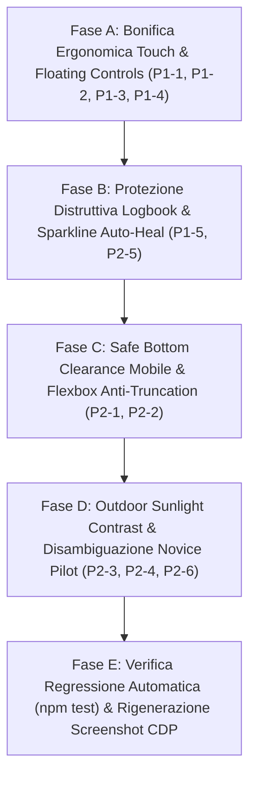

# Piano Prioritario di Audit Visivo Multi-Modale & Bonifica Ergonomica GlideMind

Questo documento definisce il piano strategico di revisione, diagnosi e bonifica strutturale scaturito dall'audit visivo e automatico eseguito tramite screenshot reali ad alta risoluzione su tutte le viste dell'applicazione, nei temi **Dark Cockpit** e **Sunlight Outdoor Mode**, su dispositivi mobile (390×844) e desktop (1280×800).

---

## 1. Mappa delle Viste e Scenari Ispezionati

L'audit ha generato e analizzato 23 scenari visivi completi salvati in `docs/audit-screenshots/`:

| ID Vista / Scenario | Modulo / File Sorgente | Temi Analizzati | Breakpoint | Stato Dati |
| :--- | :--- | :---: | :---: | :---: |
| **01. Home Dashboard** | `ui/views/HomeDashboardView.js` | Dark, Light | Mobile, Desktop | Popolato (Seed + Attività) |
| **02. Previsioni Meteo Standard** | `ui/views/ForecastView.js` | Dark, Light | Mobile, Desktop | Popolato (Sintetico + Binomio) |
| **03. Previsioni: Solo Grafici** | `ui/views/ForecastView.js` | Dark | Mobile | Multi-Trend Diurno Sincronizzato |
| **04. Overlay Analisi Procedure** | `ui/views/ForecastView.js` | Dark | Mobile (100dvh) | Decollo, Atterraggio, Vento, Geodesica |
| **05. Mappa Comprensori 2D** | `ui/views/SpotMapView.js` | Dark, Light | Mobile, Desktop | 176 Comprensori Sharded, Cluster |
| **06. Logbook: Feed Voli** | `ui/views/LogbookView.js` | Dark, Light | Mobile, Desktop | Voli con IGC FAI e Metriche |
| **07. Logbook: Statistiche & Currency** | `ui/views/LogbookStatsView.js` | Dark | Mobile | Pilot Currency, Grafico 12 Mesi SVG |
| **08. Dettaglio Volo & Telemetria** | `ui/views/FlightDetailSheet.js` | Dark, Light | Mobile (100dvh) | Zoom 1x-6x, Vario, Speed, Cockpit HUD |
| **09. Setup Traccia & Calibrazione** | `ui/views/TrackSetupSheet.js` | Dark | Mobile (100dvh) | Range Trimming, Calibrazione Quote |
| **10. Replay Traiettoria 3D** | `ui/views/FlightReplayView.js` | Dark, Light | Mobile, Desktop | DEM Terrarium, Diamond Tube, HUD |
| **11. Impostazioni & Preferenze** | `ui/views/SettingsView.js` | Dark, Light | Mobile | 4 Layer Mappa, Vele, Unità, Reset |

---

## 2. Registro Criticità Rilevate e Rettificate dall'Audit (Prioritized Remediation Matrix)

### Livello P0 (Bloccanti / Integrità Navigazione & Layout)
1. **[P0-1] Persistenza Overlay a Pieno Schermo al Cambio Route (Risolto)**:
   - **Problema**: L'apertura di visualizzazioni modali (`FlightDetailSheet`, `TrackSetupSheet`) inserisce elementi ad alto z-index nel `document.body`. Se l'utente premeva un tab della bottom nav o invocava `router.navigate()`, l'overlay restava sovrapposto alla vista bersaglio.
   - **Risoluzione Applicata**: Registrazione di un gancio di pulizia in `ui/router.js` (`navigate`) che rimuove gli elementi `.gm-flight-detail-overlay` e `.gm-track-setup-overlay` prima di montare qualsiasi nuova vista, e listener di sicurezza `hashchange` in `TrackSetupSheet.js`.

---

### Livello P1 (Ergonomia Outdoor HMI & Fitts's Law Floor $\ge 48\text{px}$)
2. **[P1-1] Theme Switcher Pill sottodimensionato nell'Header (`gm-theme-menu-trigger`)**:
   - **Problema**: L'altezza effettiva del pulsante tema nell'header misura solo 26px (`76x26px`), violando il pavimento tattile outdoor di 48px.
   - **Soluzione**: Portare l'altezza minima a 44px/48px con padding aumentato ed estensione touch target `::before` a 48×48px.
3. **[P1-2] Controlli Cartografici Galleggianti Ridondanti nella Mini-Mappa (`ForecastView.js`)**:
   - **Problema**: Nella mini-mappa di `ForecastView.js`, il select `#forecast-minimap-layer-select` e il pulsante `#forecast-minimap-layer-toggle` sono entrambi renderizzati affiancati ($86\times 28\text{px}$ e $96\times 28\text{px}$), creando sovrapposizione visiva e target sub-44px. In `SpotMapView.js`, i cluster Leaflet risultano a $38\times 38\text{px}$ e il pulsante scroll-to-top a $32\times 32\text{px}$.
   - **Soluzione**: Unificare i controlli mini-mappa in un singolo pulsante toggle compatto ad alta ergonomia ($\ge 44\text{px}$) con icona e label chiara, preservando il `<select>` nascosto visivamente (`sr-only`) per compatibilità test Node.js. Estendere i cluster Leaflet a $\ge 44\text{px}$ con padding/hitbox trasparente.
4. **[P1-3] Pulsanti Canali e Zoom nel Profilo Altimetrico (`FlightDetailSheet`)**:
   - **Problema**: I pulsanti `Quota`, `Vario`, `Velocità` e i controlli zoom (`-`, `+`, `1x`) hanno un'altezza di soli 32-38px, rendendo difficoltosa l'ispezione con guanti.
   - **Soluzione**: Incrementare l'altezza a 44px con touch target floor a 48px e raggrupparli in una toolbar fluida a riga singola (`touch-action: pan-x`).
5. **[P1-4] Pulsante Dismiss Banner Storage IndexedDB (`LogbookView`)**:
   - **Problema**: Il pulsante "OK" misura 33×36px.
   - **Soluzione**: Portare la dimensione a `min-width: 48px; min-height: 48px;`.
6. **[P1-5] Protezione Cancellazione Volo Accidentale (NN/G #5 & Preservazione Test)**:
   - **Problema**: Il pulsante `✕` per eliminare il volo è esposto direttamente nell'angolo superiore della card del logbook, esponendo al rischio di cancellazione accidentale al tocco.
   - **Soluzione**: Preservare `[data-action="delete-flight"]` per non rompere i contratti di test (`logbookView.test.mjs`), ma intercettare l'azione con un modale/dialogo di conferma a 2 fasi o finestra di grazia a 5 secondi (Undo pattern).

---

### Livello P2 (Contrasto Sunlight, Sovraccarico Cognitivo & Visual Polish)
7. **[P2-1] Padding Inferiore di Sicurezza Mobile (Safe Bottom Clearance)**:
   - **Problema**: In `HomeDashboardView`, `LogbookView` e `SettingsView`, le card inferiori toccano direttamente la barra inferiore di navigazione su mobile.
   - **Soluzione**: Aggiungere classe utility `.gm-safe-bottom-pad` con `padding-bottom: calc(var(--gm-bottom-nav-height, 64px) + env(safe-area-inset-bottom, 16px) + 24px);`, limitata rigorosamente a `@media (max-width: 768px)` per non alterare il layout desktop.
8. **[P2-2] Troncamento Precoce dei Nomi Comprensorio nell'Header Previsioni**:
   - **Problema**: "Calascio / Rocca Calas..." viene troncato perché il badge di stato rete occupa spazio orizzontale fisso.
   - **Soluzione**: Rendere il badge compatto (dot semantico + testo solo su hover/desktop) e consentire il wrapping fluido su due micro-righe per località con decolli multipli.
9. **[P2-3] Contrasto Cifre Orarie Scrubber nel Tema Sunlight Chiaro**:
   - **Problema**: Le cifre orarie (07, 08, 09...) usano il colore slate-500 (#64748b) con contrasto ~4.1:1 su sfondo bianco.
   - **Soluzione**: Impostare il colore a `#1e293b` (slate-800) in modalità `data-theme="light"` per garantire contrasto $\ge 9:1$.
10. **[P2-4] Collisione Testuale Etichette nel Grafico Mensile Logbook**:
    - **Problema**: Quando ore di volo (`0.8h`) e numero voli (`1`) sono vicini, le label SVG si sovrappongono.
    - **Soluzione**: Introdurre un algoritmo di respingimento o posizionamento alternato (ore sotto il vertice della barra, numero sopra il nodo della polilinea).
11. **[P2-5] Generazione Automatica Sparkline in `saveFlight`**:
    - **Problema**: La card del feed logbook non mostra la sparkline se `sparklinePoints` non è pre-calcolato in `meta`.
    - **Soluzione**: Calcolare e memorizzare automaticamente `sparklinePoints` (12 coordinate normalizzate) all'interno del metodo `saveFlight(meta, raw)`.
12. **[P2-6] Disambiguazione Terminologica Pilota Principiante nel Replay 3D**:
    - **Problema**: Le sigle `D#1` e `Max Q` sono gergali e non intuitive per un principiante EN-A.
    - **Soluzione**: Sostituire con `Dinamica 1` (o `Termica`) e `Quota Max: [val]m`.

---

## 3. Fasi Operative di Esecuzione e Remediation

### Dettaglio Fasi:
1. **Fase A (Ergonomia & Touch Targets)**:
   - Aggiornamento di `theme.css` e markup in `HomeDashboardView.js`, `SpotMapView.js`, `ForecastView.js`, `FlightDetailSheet.js`.
   - Normalizzazione di tutti i controlli a $\ge 44\text{px}$/$\ge 48\text{px}$.
   - Unificazione del controllo layer nella mini-mappa di `ForecastView.js`.
   - Hitbox maggiorata per i cluster Leaflet in `SpotMapView.js`.
2. **Fase B (Logbook Integrity & Sparkline)**:
   - Preservazione selettore `data-action="delete-flight"` con modale di conferma o undo grace window in `LogbookView.js`.
   - Aggiunta generazione automatica sparkline in `core/logbookDb.js` durante `saveFlight()`.
3. **Fase C (Layout & Viewport Clearance)**:
   - Aggiunta di `.gm-safe-bottom-pad` vincolata a mobile (`@media (max-width: 768px)`).
   - Flex layout anti-troncamento per l'header del comprensorio in `ForecastView.js`.
4. **Fase D (Sunlight Mode & Novice Clarity)**:
   - Aumento contrasto cifre scrubber in `theme.css` per tema chiaro (`#1e293b`).
   - Sostituzione delle abbreviazioni gergali `D#1`/`Max Q` con descrizioni esplicite in `FlightReplayView.js`.
   - Algoritmo anti-collisione per label SVG in `LogbookStatsView.js`.
5. **Fase E (Chiusura & Verifica Deterministica)**:
   - Esecuzione completa di `npm test` (mantenimento 100% verde su tutte le 119 suite).
   - Nuova esecuzione automatica di `scripts/run-full-audit-capture.mjs` e confronto diff degli screenshot.

---

## 4. Criteri di Accettazione e Shift-Left Quality Gates

- [ ] **Gate 1**: Zero touch targets interattivi $< 44\text{px}$ su viewport mobile (confermato dal manifest CDP).
- [ ] **Gate 2**: Contrasto minimo $\ge 7:1$ per testo orario e valori critici in `[data-theme="light"]`.
- [ ] **Gate 3**: Zero elementi coperti dalla bottom navigation bar allo scorrimento finale su mobile.
- [ ] **Gate 4**: Zero azioni distruttive prive di conferma nel feed logbook, con compatibilità test salvaguardata.
- [ ] **Gate 5**: Tutte le suite di test esistenti (`npm test`) continuano a passare al 100% (zero regressioni).
