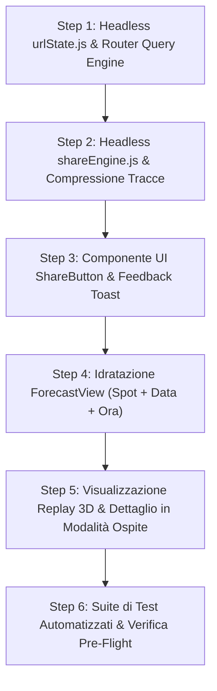

# Piano Architetturale: Condivisione Universale Contestuale, Deep Linking & Visualizzazione Volo Ospite

> **Fase**: Fase 7-bis  
> **Stato**: 🔴 Prioritario  
> **Target Repo**: `GlideMind`  
> **Moduli Coinvolti**: `core/urlState.js`, `core/shareEngine.js`, `ui/router.js`, `ui/components/ShareButton.js`, `ui/views/ForecastView.js`, `ui/views/FlightReplayView.js`, `ui/views/FlightDetailSheet.js`, `ui/views/HomeDashboardView.js`, `ui/views/SpotMapView.js`, `tests/core/urlState.test.mjs`, `tests/core/shareEngine.test.mjs`, `tests/ui/router.test.mjs`

---

## 1. Visione di Dominio & Requisito Utente

Nel volo libero in parapendio e deltaplano, la comunicazione tra piloti avviene prevalentemente tramite canali di messaggistica mobile (WhatsApp, Telegram, Signal) prima, durante e dopo la giornata di volo:
1. **Pre-volo (Pianificazione Meteo)**: Un pilota individua una finestra di volabilità favorevole per un determinato sito a un'ora precisa (es. *"Monte Cornizzolo ore 14:00 con termica attiva e base cumulo a 1800m"*) e desidera inoltrare esattamente quella configurazione ai compagni di club con un solo tocco.
2. **Post-volo (Debriefing & Tracciato)**: Un pilota atterra, registra o importa la traccia del volo e vuole inviarla agli amici. Chi riceve il link deve poter aprire la traiettoria direttamente in **"Modalità Ospite / Solo Visualizzazione"** nel visualizzatore 3D o nella scheda di dettaglio, senza dover possedere il file localmente né inquinare il proprio libretto personale, ma con la facoltà di salvarlo con un tocco.
3. **Generale (Applicazione & Mappe)**: Condivisione dell'intera applicazione dalla Home o di uno specifico decollo dalla Mappa comprensori.

Questo piano definisce l'architettura per un **pulsante di condivisione universale e contestuale** supportato da un robusto motore di **Deep Linking** e **serializzazione traccia senza backend**.

---

## 2. Punti Critici & Scelte Architetturali (Anti-Sycophancy Review)

### 2.1. Il Vincolo PWA Senza Backend (Zero-Cloud Storage)
- **Problema**: GlideMind è una PWA statica e offline-first senza server applicativo né database centralizzato a pagamento. I voli registrati o importati risiedono esclusivamente nell'IndexedDB locale del dispositivo del pilota.
- **Risoluzione**:
  - Per voli di default o seed (es. `fl-1`), il link trasmette l'ID normalizzato (`#replay?flightId=fl-1`).
  - Per voli personali importati da file IGC, il sistema adotta un motore di **Decimated Track Snapshot**:
    1. La traccia viene decimata con algoritmo LTTB a 150–200 punti chiave `[lat, lon, alt, time]`.
    2. Il vettore viene serializzato in binario compatto e compresso in memoria tramite API nativa standard `CompressionStream('deflate')` o delta-encoding.
    3. La stringa risultante in formato Base64URL (< 1.5 KB) viene inclusa nel frammento URL (`#replay?guest=1&track=<base64url>`).
    4. Il payload rientra ampiamente nei massimali di sicurezza dei client di messaggistica (< 2000 caratteri).
  - In aggiunta, sui dispositivi mobili la Web Share API (`navigator.share`) supporta la condivisione diretta del file `.igc` FAI originale come allegato.

### 2.2. Prevenzione dell'Inquinamento della Cronologia del Browser
- Durante lo scrubbing continuo della timeline oraria nelle previsioni (08:00 - 20:00), è vietato invocare `window.history.pushState` ad ogni frame di movimento del dito per evitare di intrappolare il tasto "Indietro" del browser.
- I parametri orari vengono serializzati nello stato volatile e aggiornati nell'URL unicamente al momento del tocco del pulsante Condividi o tramite `history.replaceState` debounced.

---

## 3. Specifiche Tecniche dei Moduli

### 3.1. `core/urlState.js` (Headless Core)
Modulo a purezza di dominio (zero dipendenze DOM o browser, 100% eseguibile e testabile in Node.js):
- **`parseHashQuery(hash)`**: Analizza il frammento hash (es. `#forecast?spot=cornizzolo&hour=14`) e restituisce un oggetto strutturato `{ route: 'forecast', params: { spot: 'cornizzolo', hour: 14 } }`.
- **`buildHashUrl(route, params)`**: Compone deterministicamente l'URL hash normalizzato escludendo parametri nulli o di default.
- **`compressTrackSnapshot(trackBundle, targetPoints = 150)`**: Riduce la traccia e restituisce la stringa Base64URL compatta.
- **`decompressTrackSnapshot(base64Str)`**: Ricostruisce l'array di punti `[{ lat, lon, alt, time }]` e i metadati essenziali di volo.
- **`validateUrlPayloadSize(url)`**: Verifica che la lunghezza non superi la soglia di sicurezza di 1.800 caratteri.

### 3.2. `core/shareEngine.js` (Headless Context Resolver)
Determina cosa condividere interrogando lo stato reattivo di `core/store.js`:
```javascript
export function resolveSharePayload({ currentRoute, storeState, activeContext }) {
  // Ritorna:
  // {
  //   title: string,        // Es. "Previsioni Monte Cornizzolo - 12 Ott ore 14:00"
  //   text: string,         // Sintesi meteo / debriefing glanceable
  //   url: string,          // Deep link completo
  //   files?: File[]        // File IGC opzionale per Web Share API
  // }
}
```

Dettaglio contesti:
- **`home`**: URL `#home` con claim istituzionale e link PWA.
- **`forecast`**: Titolo con nome comprensorio, data, ora selezionata; testo con volabilità sintetica e vento; URL `#forecast?spot=<id>&date=<ISO>&hour=<HH>&subspot=<id>`.
- **`map`**: Titolo comprensorio/macro-regione; coordinate e zoom; URL `#map?spot=<id>&lat=<N>&lon=<E>&zoom=<Z>`.
- **`replay` / `logbook`**: Titolo volo, quota max, durata; URL con `flightId` o snapshot compresso `track`; testo con prestazione del volo.

### 3.3. `ui/router.js` (Aggiornamento Routing)
- Aggiornamento di `normalizeRoute()` per gestire query string nell'hash senza troncare i parametri.
- Estrazione dei parametri all'evento `hashchange` e passaggio automatico al metodo `mount(containerEl, params)` del controller registrato.

### 3.4. `ui/components/ShareButton.js` & Feedback Visivo
- Pulsante accessibile touch-target $\ge 48\times 48\text{px}$ provvisto di `aria-label="Condividi"`.
- Flusso di condivisione:
  1. Invoca `resolveSharePayload()`.
  2. Se `navigator.share` è supportato: attiva il foglio di condivisione nativo di sistema.
  3. Se non supportato: copia l'URL negli appunti tramite `navigator.clipboard.writeText()` e mostra un Toast non invasivo in sovrimpressione (*"Link copiato negli appunti!"*, con dissolvenza in 2.5s).

### 3.5. Visualizzazione Volo Ospite ("Modalità Visualizzazione")
In `ui/views/FlightReplayView.js` e `ui/views/FlightDetailSheet.js`:
- Rilevamento del parametro `guest=1` o presenza di `track` nell'URL.
- Montaggio con banner in testata: *"Modalità Visualizzazione: Volo Condiviso"*.
- Disabilitazione dei pulsanti di eliminazione o modifica note per evitare mutazioni accidentali.
- Inserimento del pulsante primario: *"Salva nel mio libretto"* che inserisce stabilmente il volo nell'IndexedDB dell'utente ricevente.

---

## 4. Fasi Operative di Realizzazione (Roadmap Step-by-Step)



1. **Step 1 - Core `urlState.js` & Router Query String Support**:
   - Implementazione di parser, encoder e validatore dimensioni URL.
   - Aggiornamento di `ui/router.js` per estrarre e propagare i parametri di rotta.
2. **Step 2 - Core `shareEngine.js` & Snapshot Tracce**:
   - Implementazione della compressione/decompressione LTTB Base64URL.
   - Risoluzione contestuale per Home, Previsioni, Mappe e Voli.
3. **Step 3 - Componente UI ShareButton & Notifica Toast**:
   - Creazione del pulsante ergonomico con icona SVG standard.
   - Integrazione Web Share API e fallback Clipboard Toast.
4. **Step 4 - Idratazione Contestuale in Previsioni e Mappa**:
   - `ForecastView.js`: lettura parametri `spot`, `date`, `hour`, selezione nello scrubber ed esecuzione fetch meteo.
   - `SpotMapView.js`: centratura dinamica su spot indicato da link esterno.
5. **Step 5 - Modalità Ospite nei Voli (3D Replay e Scheda Dettaglio)**:
   - Decompressione della traccia al volo senza persistenza automatica forzata.
   - Banner esplicito "Volo Condiviso (Sola Lettura)" e azione opzionale "Salva nel mio libretto".
6. **Step 6 - Collaudo & Test di Governance Shift-Left**:
   - Test unitari headless (`tests/core/urlState.test.mjs`, `tests/core/shareEngine.test.mjs`).
   - Test UI di integrazione per routing ed idratazione parametri.

---

## 5. Shift-Left Pre-Flight Quality Gates

- **Gate 1 (UX & Ergonomia Outdoor)**: Touch target $\ge 48\times 48\text{px}$, toast accessibile WAI-ARIA `role="status"` o `aria-live="polite"`, nessun blocco visivo.
- **Gate 2 (Headless Core & Disaccoppiamento)**: `core/urlState.js` e `core/shareEngine.js` 100% indipendenti dal browser, testabili in Node.js puro.
- **Gate 3 (Automazione)**: 100% test verdi con soglia runtime < 1s.
- **Gate 4 (Ispezione Geometrica)**: Zero overflow orizzontale su schermi mobile stretti ($360\text{px} - 390\text{px}$).
- **Gate 5 (Sobrietà Ingegneristica)**: Codice ed identificatori in inglese rigoroso, etichette UI in italiano, zero emoji decorative.
